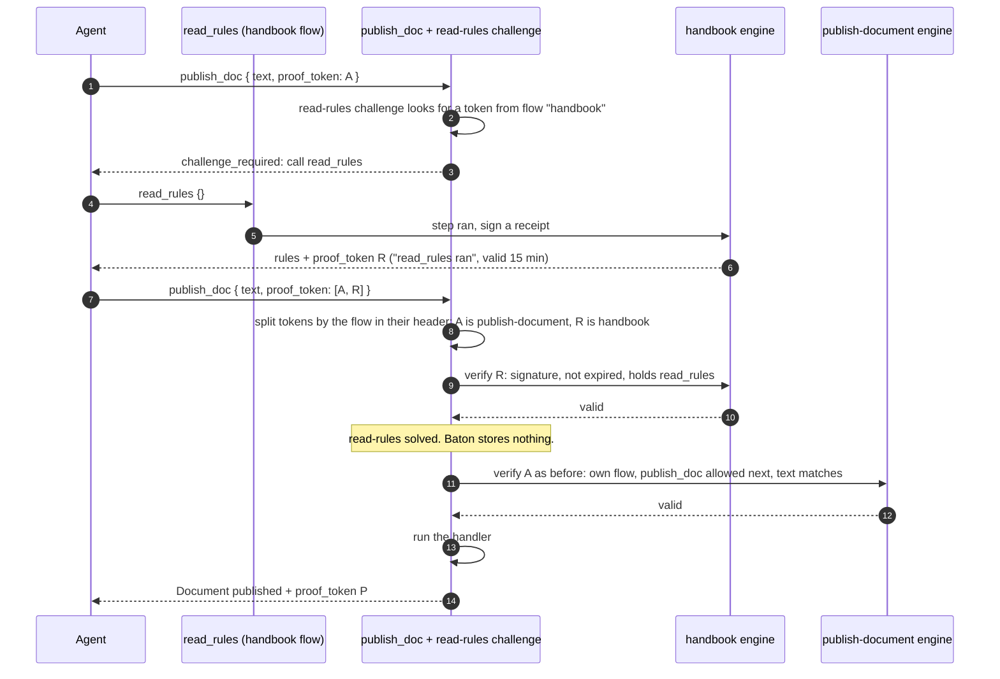

# baton

<p align="center">
  
</p>

**Enforce tool dependencies without building another agent framework.**

<p align="center">
  <picture>
    <source media="(prefers-reduced-motion: reduce)" srcset="https://raw.githubusercontent.com/superaligned-to/baton/main/.github/media/workflow.png">
    
  </picture>
</p>

Agents can skip steps. Your tools don’t have to let them.

- Require a read before an edit.
- Require tests and review before a release.
- Bind publishing to the exact artifact that passed its checks.

> [!NOTE]
> **For agents:** [MCP integration](#mcp) · [Calling gated tools](#calling-gated-tools) · [Challenges](#calling-challenged-tools) · [Repo instructions](AGENTS.md) · [Docs index](llms.txt).
> Keep the existing server and handlers. Pass `proof_token` unchanged and follow the reply’s `Next:` guidance.

## Install

Requires **Node 22.9+**. [Available on npm](https://www.npmjs.com/package/@superaligned/baton).

| Package manager | Command |
| --- | --- |
| npm | `npm install @superaligned/baton` |
| pnpm | `pnpm add @superaligned/baton` |
| Bun | `bun add @superaligned/baton` |
| Yarn | `yarn add @superaligned/baton` |

Set a signing secret:

```sh
export BATON_SECRET="$(openssl rand -base64 32)"
```

Use the same secret in every process serving a flow. Changing it invalidates existing tokens.

## Read before editing

Import the core directly; Zod is not required. Wrap the handlers, then pass the returned proof to the next call. `from` binds the edit to the document that was read.

```ts
import { readFile, writeFile } from "node:fs/promises";
import { baton } from "@superaligned/baton";

const flow = baton({ name: "edit-document", secret: process.env.BATON_SECRET ?? "" });

const read = flow
  .step("read_doc")
  .description("Read a document before editing it.")
  .func(async ({ doc }: { doc: string }) => ({
    doc,
    text: await readFile(doc, "utf8"),
  }));

const edit = flow
  .step("edit_doc", { from: { doc: read.output((result) => result.doc) } })
  .description("Edit the document that was read.")
  .func(async ({ doc, text }: { doc: string; text: string }) => {
    await writeFile(doc, text);

    return { doc, text };
  });

const opened = await read({ doc: "notes.md" });

await edit({
  doc: "notes.md",
  text: `${opened.result.text}\nUpdated.\n`,
  proof_token: opened.proof_token,
});
```

Calling `edit` without proof, or with a different `doc`, is refused before `writeFile` runs. `notes.md` must exist before running this example.

## API

Create a flow with `baton({ name, secret })` from `@superaligned/baton`. Wrap handlers with `flow.step(name, options).description(text).func(handler)`.

### Flow options

| Option | Default | Use |
| --- | --- | --- |
| `name` | Required | Flow identity carried in tokens |
| `secret` | Required | HMAC key of at least 32 bytes |
| `mcp` | `false` | Return MCP results and text refusals |
| `namespace` | None | Separate meta-tool names on one server |
| `grace` | `86400` seconds | Refresh window after token expiry |

Define all steps and branches before calling tools; later changes are refused. Steps without prerequisites start a new run; explicitly locked steps need a prerequisite.

### Step options

| Option | Default | Use |
| --- | --- | --- |
| `from` | None | Bind inputs to selected prerequisite outputs |
| `ttl` | `900` seconds | Evidence lifetime |
| `locked` | `true` with prerequisites | Refuse calls without valid evidence |

- `.dependsOn(first, ...others)` requires every named step.
- `from` declares prerequisites and binds inputs to `step.output(selector)`. Select from the handler result, or its `structuredContent` for MCP. Only selected values become signed evidence.
- `.branch({ when, pass, fail })` permits one next call based on the result. Return ordinary data such as `passed: false` to permit a retry.
- Rerunning an earlier step clears downstream evidence in the new token.
- Independent checks share a starting token. Pass their returned tokens together; they must belong to the same run with compatible histories.

Linked values must have compatible types, match at runtime, and contain JSON data.

Plain replies contain `result`, `proof_token`, and `next`. Refusals throw `BatonError` with a `code`. `locked: false` allows calls with invalid prerequisites, returning a `warning` and no usable proof.

## MCP

Set `mcp: true` to return MCP results with proof and next-call guidance. Choose the import that fits your server:

| Import | Schemas and registration |
| --- | --- |
| `@superaligned/baton` | Your server supplies and validates schemas, including `proof_token` |
| `@superaligned/baton/zod` | Optional Zod 4 adapter adds `proof_token` to `.schema(...)` and provides `metaTools()` |

### With your own schemas

This exports tool definitions and handlers for a server that accepts JSON Schema. A failed check issues no proof; publishing requires the exact text from a successful check.

```ts
import { writeFile } from "node:fs/promises";
import { baton } from "@superaligned/baton";

const flow = baton({
  name: "publish-document",
  secret: process.env.BATON_SECRET ?? "",
  mcp: true,
});

const check = flow
  .step("check_doc")
  .description("Check that the document starts with a Markdown heading.")
  .func(({ text }: { text: string }) => ({
    content: [
      {
        type: "text" as const,
        text: text.startsWith("# ") ? "Check passed." : "Add a Markdown heading.",
      },
    ],
    structuredContent: { text },
    isError: !text.startsWith("# "),
  }));

const publish = flow
  .step("publish_doc", {
    from: { text: check.output((result) => result.structuredContent.text) },
  })
  .description("Publish the exact text that passed its check.")
  .func(async ({ text }: { text: string }) => {
    await writeFile("published.md", text);

    return { content: [{ type: "text" as const, text: "Document published." }] };
  });

const inputSchema = {
  type: "object" as const,
  properties: {
    text: { type: "string" },
    proof_token: {
      anyOf: [
        { type: "string" },
        { type: "array", items: { type: "string" }, minItems: 1 },
      ],
    },
  },
  required: ["text"],
  additionalProperties: false,
};

export const tools = [check, publish].map((tool) => ({
  name: tool.name,
  description: tool.description,
  inputSchema,
  func: tool.func,
}));
```

Expose each tool's `name`, `description`, and `inputSchema` through your existing registration code. Validate arguments with your server's validator, then pass them to `func`, including `proof_token`. Keep that field optional so Baton can explain missing proof. The core also exposes `flow.status`, `flow.list`, and `flow.refresh` for manual registration.

### With Zod 4

1. Import `baton` from `@superaligned/baton/zod` for Zod 4 schemas and set `mcp: true`.
2. Pass application fields to `.schema(shape)`; baton adds `proof_token`.
3. Register each handle’s `name`, `description`, `schema`, and `func` with your existing server. Register `flow.metaTools()` the same way.

Keep your transport and ungated tools. This adapter uses your application's Zod 4 installation.

This registers two tools on your existing server. The check returns the exact text that publishing must use; a failed check routes back to another check.

```ts
import { writeFile } from "node:fs/promises";
import type { McpServer } from "@modelcontextprotocol/sdk/server/mcp.js";
import { baton } from "@superaligned/baton/zod";
import { z } from "zod";

export function registerDocumentTools(server: McpServer) {
  const flow = baton({
    name: "publish-document",
    secret: process.env.BATON_SECRET ?? "",
    mcp: true,
  });

  const check = flow
    .step("check_doc")
    .description("Check that the document starts with a Markdown heading.")
    .schema({ text: z.string() })
    .func(({ text }) => ({
      content: [{ type: "text" as const, text: "Document checked." }],
      structuredContent: { text, passed: text.startsWith("# ") },
    }));

  const publish = flow
    .step("publish_doc", {
      from: { text: check.output((result) => result.structuredContent.text) },
    })
    .description("Publish the exact text that passed its check.")
    .schema({ text: z.string() })
    .func(async ({ text }) => {
      await writeFile("published.md", text);

      return { content: [{ type: "text" as const, text: "Document published." }] };
    });

  check.branch({
    when: (result) => result.structuredContent.passed,
    pass: publish,
    fail: check,
  });

  server.registerTool(
    check.name,
    { description: check.description, inputSchema: check.schema },
    check.func,
  );

  for (const tool of [check, publish]) {
    server.registerTool(
      tool.name,
      { description: tool.description, inputSchema: tool.schema },
      tool.func,
    );
  }

  flow.metaTools().forEach((tool) => {
    server.registerTool(
      tool.name,
      { description: tool.description, inputSchema: tool.schema },
      tool.func,
    );
  });
}
```

Call `registerDocumentTools(server)` during setup. Use your own validation and publishing handlers in place of the heading check and local file write.

Handlers return normal MCP results. An `isError: true` result produces no completion evidence. Refusals return `isError: true` with `code: message` text.

## Challenges

A challenge locks a tool until the agent does something first: call a tool, complete a flow, or wait for a condition your application checks. While the challenge is unsolved, baton refuses the call before the handler runs, and the refusal says how to unlock it.

```ts
import type { AuthInfo } from "@modelcontextprotocol/sdk/server/auth/types.js";
import type { McpServer } from "@modelcontextprotocol/sdk/server/mcp.js";
import { challenge } from "@superaligned/baton";
import { baton } from "@superaligned/baton/zod";
import { z } from "zod";

type Extra = { authInfo?: AuthInfo };

const store = { inbox: new Map<string, string[]>(), docs: [] as string[], freeze: false };

const text = (t: string) => ({ content: [{ type: "text" as const, text: t }] });
const caller = (extra: Extra): string => extra.authInfo?.clientId ?? "anonymous";

export function registerDocumentTools(server: McpServer) {
  const secret = process.env.BATON_SECRET ?? "";

  const handbook = baton({ name: "handbook", secret, mcp: true });

  const readRules = handbook
    .step("read_rules")
    .description("Read the writing rules.")
    .schema({})
    .func(async () => text("Write for the next reader."));

  const readInbox = {
    name: "read_inbox",
    description: "Read your unread messages. Marks them read.",
    schema: {},
    func: async (_args: object, extra: Extra) => {
      const mail = store.inbox.get(caller(extra)) ?? [];

      store.inbox.delete(caller(extra));

      return text(JSON.stringify(mail));
    },
  };

  const inboxRead = challenge({ name: "read-inbox", mcp: true })
    .call(readInbox)
    .check(async (_args: object, extra: Extra) => !store.inbox.has(caller(extra)));

  const rulesRead = challenge({ name: "read-rules", mcp: true }).call(readRules);

  const freezeOver = challenge({
    name: "release-freeze",
    description: "wait until the release freeze ends",
    mcp: true,
  }).check(async () => !store.freeze);

  const publishing = baton({ name: "publish-document", secret, mcp: true });

  const check = publishing
    .step("check_doc")
    .withChallenge(inboxRead)
    .description("Check that the document starts with a Markdown heading.")
    .schema({ text: z.string() })
    .func(({ text: body }) => ({
      ...text("Document checked."),
      structuredContent: { text: body, passed: body.startsWith("# ") },
    }));

  const publish = publishing
    .step("publish_doc", { from: { text: check.output((r) => r.structuredContent.text) } })
    .withChallenge(rulesRead)
    .withChallenge(freezeOver)
    .description("Publish the exact text that passed its check.")
    .schema({ text: z.string() })
    .func(async ({ text: body }) => {
      store.docs.push(body);

      return text("Document published.");
    });

  check.branch({ when: (r) => r.structuredContent.passed, pass: publish, fail: check });

  const list = {
    name: "list_docs",
    description: "List published documents.",
    schema: {},
    func: inboxRead.func(async (_args: object, _extra: Extra) => text(JSON.stringify(store.docs))),
  };

  for (const tool of [readInbox, list]) {
    server.registerTool(tool.name, { description: tool.description, inputSchema: tool.schema }, tool.func);
  }

  for (const tool of [readRules, check, publish]) {
    server.registerTool(tool.name, { description: tool.description, inputSchema: tool.schema }, tool.func);
  }

  for (const tool of publishing.metaTools()) {
    server.registerTool(tool.name, { description: tool.description, inputSchema: tool.schema }, tool.func);
  }
}
```

The example uses each kind of challenge. `read-inbox` names `read_inbox` and is solved when the caller's inbox is empty; it locks `check_doc` and the plain `list_docs` handler. `read-rules` is solved by proof that `read_rules` ran, and that proof comes from the `handbook` flow. `release-freeze` has no tool to call and is solved when the freeze ends.

An agent's session:

```text
check_doc { "text": "# Release notes" }
→ challenge_required: This tool is locked by challenge: read-inbox. Solve it to unlock: call read_inbox.

read_inbox {}
→ ["Use the new template."]

check_doc { "text": "# Release notes" }
→ Document checked.
  proof_token: bt1.publish-document.check_doc>publish_doc.…
  Next: publish_doc {"text":"# Release notes"}. Pass the proof_token.

publish_doc { "text": "# Release notes", "proof_token": "<A>" }
→ challenge_required: This tool is locked by challenge: read-rules. Solve it to unlock: call read_rules.

read_rules {}
→ Write for the next reader.
  proof_token: bt1.handbook.read_rules>~.…
  This flow is finished.

publish_doc { "text": "# Release notes", "proof_token": ["<A>", "<R>"] }
→ challenge_required: This tool is locked by challenge: release-freeze. Solve it to unlock: wait until the release freeze ends.

publish_doc { "text": "# Release notes", "proof_token": ["<A>", "<R>"] }
→ Document published.
```

### How proof moves between flows

A proof token is a signed receipt that a step ran, and its header names the flow that signed it. A step with challenges sorts the tokens it receives by that flow. Each challenge checks the receipts from its own flow with that flow's engine, and the step's engine sees only the step's own tokens, as before. Baton stores nothing: a challenge is solved by a valid receipt or by its check.



R stays out of P, so the next publish shows R again while it is valid. When R expires (the `read_rules` step's `ttl`), the challenge locks again.

### Challenge API

| Call | Use |
| --- | --- |
| `challenge({ name, description?, mcp? })` | Start a challenge. `description` replaces the instruction in the refusal. `mcp: true` makes `.func()` return refusals as MCP results. |
| `.call(tool)` | The agent must call `tool`. It stays callable while the challenge is unsolved. |
| `.follow(flow, end)` | The agent must complete `flow` by reaching its step `end`. Every step of `flow` stays callable while the challenge is unsolved. |
| `.check(fn)` | Async callback that receives the call's arguments and extra parameters and returns `true` when solved. It runs on every call. |
| `.func(fn)` | Lock a plain handler behind the challenge. |
| `.lets(name)` | `true` for the tools that stay callable while the challenge is unsolved. |
| `step.withChallenge(c)` | Lock a step. Challenges run in the order attached, before the step's own proof checks. A challenge cannot name the step's own flow; use `dependsOn` for that. |

| Challenge | Solved when |
| --- | --- |
| `.call(tool)` | The call's `proof_token` proves `tool` ran and that proof is not expired |
| `.follow(flow, end)` | The call's `proof_token` proves `end` ran and that proof is not expired |
| Any challenge with `.check(fn)` | `fn` returns `true`; proof is not needed |

A challenge needs `.check()` unless it calls a baton step or follows a baton flow, and it needs a description unless it calls or follows something. It takes one `.call()` or `.follow()` and one `.check()`. `.func()` locks every handler it wraps, including the challenge's own tool, so wrap only the handlers whose name `.lets()` rejects. A `.follow()` challenge reads its flow's graph when it explains itself or answers `.lets()`, so finish defining that flow first. To receive proof, a plain handler wrapped with `.func()` needs `proof_token` in its input schema.

### Calling challenged tools

1. On `challenge_required`, do what the refusal says, then retry the same call.
2. Pass proof from another flow together with the call's own token, as a `proof_token` array.
3. A challenge that only checks state is solved by the application. Retry once the condition changes.

## Calling gated tools

1. Call an entry tool.
2. Pass its complete `proof_token` unchanged to a tool named in `Next:`, using the linked inputs shown.
3. Follow each reply’s next-call guidance. Keep both tokens for independent branches that later join.
4. Stop at `This flow is finished.`

> [!TIP]
> Call `baton_status` only when the reply’s next-call guidance is insufficient.

Refusals include an error code and instructions to continue.

### Meta tools

| Core | MCP tool | Returns |
| --- | --- | --- |
| `flow.status` | `baton_status` | Completions, evidence, next inputs, remaining token lifetime |
| `flow.list` | `baton_list` | Tool graph and entry tools |
| `flow.refresh` | `baton_refresh` | Renewed token within `grace`; prerequisite lifetimes stay unchanged |
| `flow.graph` | `baton_workflows` | Registered workflows, or one graph as JSON or Mermaid; no token |

Status, list, and refresh accept a token or compatible token array through `proof_token`. Status and list require an unexpired token. Expired prerequisites must run again. With `namespace: "docs"`, meta-tool names use the `baton_docs_` prefix.

### Workflow catalog

`flow.list` reads one flow and requires a token. The Zod adapter's `metaTools()` also returns `baton_workflows`, which lists every flow created in the process and exposes one graph as JSON or Mermaid. It needs no proof token.

| Argument | Values | Use |
| --- | --- | --- |
| `workflow` | A workflow name | Return this workflow's graph instead of the list |
| `format` | `json` (default) or `mermaid` | Choose structured data or a diagram |

JSON without `workflow` returns each workflow's entry tools and step count. JSON with `workflow` returns the full graph, including dependencies, links, and branch targets. Mermaid returns a `flowchart` with sequential edges and labeled pass/fail branches. The catalog requires no proof token because it exposes structure, never evidence.

`flow.graph()` exposes one flow graph to code without a token.

## Limits

> [!IMPORTANT]
> Proof records a completed handler call. Your handler decides what counts as success. A refused call does not run the handler or issue proof.

- Tokens carry state and can be replayed until expiry. Issuing a new token does not revoke old ones.
- Your application checks whether an artifact is still current and prevents duplicate side effects.
- Linked values are readable in the token. Keep secrets out of them.
- A challenge solved by proof accepts any valid token from any caller until it expires. Use `.check()` when the challenge must hold for one agent.
- `.check()` receives the call's arguments before baton verifies them. Trust only what your server puts in the extra parameters.

## Versioning

During `0.x`, breaking changes bump the minor version and compatible fixes bump the patch. From `1.0.0`, releases follow [SemVer](https://semver.org/).

## Changelog

See [CHANGELOG.md](CHANGELOG.md).

[MIT license](LICENSE). [Report a bug](https://github.com/superaligned-to/baton/issues).
